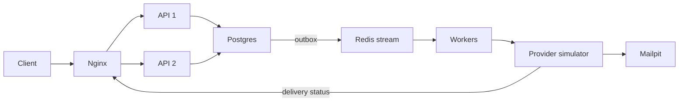

# Reliable Notification Platform

A small email notification service built around one problem: **a retry must not send a second email.**

`POST /v1/notifications` returns 202 as soon as the notification is stored in Postgres. A worker sends the email later. If sending fails, it retries with backoff; if it keeps failing, the notification ends up on a dead-letter list. Sending the same request again with the same `Idempotency-Key` returns the first result instead of a second email.



Two copies of the same API run behind Nginx. Mailpit catches every email, so nothing reaches a real inbox. The design is explained on one page: [docs/architecture.md](docs/architecture.md).

## Run it

Requires Docker with Compose v2.

```bash
docker compose up --build -d
docker compose ps
```

Wait until both APIs are healthy, then send one:

```bash
curl http://localhost:8090/v1/notifications \
  -H "x-api-key: nplat_live_dev_demo_key_do_not_use_in_prod" \
  -H "idempotency-key: demo-1" \
  -H "content-type: application/json" \
  -d '{"userId":"user-1","type":"order.shipped","payload":{"name":"Ada","orderId":"42"}}'
```

Run the same command again: you get the same id back with `"replay": true`, and Mailpit still shows one email. The seeded API key is public on purpose and only works on local demo data.

To see a failure, add `"_test":{"failureMode":"transient"}` (retries, then dead) or `"_test":{"failureMode":"permanent"}` (dead straight away) to `payload`. This only works while `ALLOW_TEST_FAILURES=true`, which the local compose file sets.

| Page | URL |
|---|---|
| Console (outbox, attempts, retries, inbox) | http://localhost:8090/console/ |
| Test inbox | http://localhost:8090/console/inbox/ |
| Mailpit | http://localhost:8090/mailpit/ |
| API docs | http://localhost:8090/docs/ |
| Grafana dashboard | http://localhost:3011/d/nplat-overview |
| Prometheus | http://localhost:9093 |


## One measured number

On 2026-08-18, on a laptop, `node load-tests/run-bench.mjs` sent 25 requests per second for 20 seconds: 500 of 500 returned HTTP 202, and end-to-end p95 (accept to delivered) was about 1.83 s. That is one laptop observation, not production capacity. The run also mixed SMS and push requests, which this version no longer has.

## Tradeoff

Delivery is at least once, not exactly once. A worker can crash after the provider took the email but before the status was saved, and then the job runs again. What keeps that from becoming a second email is the idempotency key: the API stores one response per key, and the worker passes the notification id to the provider as its own idempotency key, so a repeat call gets the first result back.

The provider simulator reports delivery by posting a status to `/v1/webhooks/email`. A real provider would sign that callback; here it only sends a shared secret.

## Metrics and deploy

The API and workers expose Prometheus counters on `/metrics` for accepted, delivered, retrying, and dead notifications. Prometheus scrapes them, and one Grafana dashboard (link above, anonymous read access) shows those four.

There is no Terraform here. Deploying means running the same Compose stack on one host with the overlay:

```bash
cp env.production.example .env   # fill in every secret; never commit .env
docker network create portfolio-edge 2>/dev/null || true
docker compose -f docker-compose.yml -f docker-compose.prod.yml up -d --build
```

The overlay removes the host ports for Postgres, Redis, Prometheus, Grafana, and Mailpit, turns off the test failure switch, and attaches Nginx to an existing edge proxy network.

## Development

```bash
npm ci
npm run typecheck
npm run build
npx vitest run tests/unit
npx vitest run tests/integration   # needs Docker (Testcontainers)
```

## Layout

```text
apps/api                 Express API, outbox dispatcher, delivery-status webhook
apps/worker              reads the Redis stream and calls the provider
apps/scheduler           re-enqueues retries once next_attempt_at has passed
apps/provider-simulator  fake email provider: sends to Mailpit, posts status back
apps/web                 console served by Nginx
packages/shared          database, queue, locks, metrics, migrations
infra                    Nginx, Prometheus, Grafana, Dockerfiles
tests                    Vitest unit tests and Testcontainers integration tests
load-tests               the load script behind the number above
```
