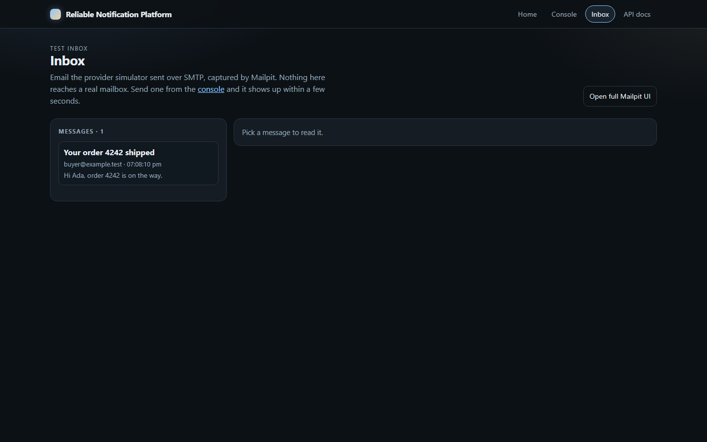

# Reliable Notification Platform

An email notification platform built around one guarantee: **a retry must never send a second email.**

`POST /v1/notifications` returns `202 Accepted` once the notification, transactional outbox row, and idempotency record commit together in PostgreSQL. Stateless dispatchers move outbox rows into Redis Streams, and workers acquire distributed locks before calling an idempotent email provider (captured safely by Mailpit).


## Key Guarantees

- **Transactional Outbox (`FOR UPDATE SKIP LOCKED`):** `notifications`, `outbox_events`, `audit_events`, and `idempotency_records` commit atomically so accepted work cannot be lost between DB commit and queue push.
- **3-Layer Idempotency:** API `Idempotency-Key` SHA-256 request digest checking (`409` on payload mismatch, `202` replay on match), Redis `SET NX PX` + Lua token locks in workers, and provider-level `notificationId` idempotency keys.
- **Backoff, PEL Reclaim & DLQ:** Failed transient deliveries enter `retrying` with full-jitter exponential backoff (`500 ms` base, `30 s` cap) and are re-enqueued by `apps/scheduler`; crashed worker jobs are reclaimed via Redis `XCLAIM`; permanent or exhausted failures route to `nplat:jobs:dlq`.
- **Observability & Admin Console:** Prometheus counters/histograms on `/metrics`, Grafana dashboard (`:3011`), live outbox/attempt inspector console, and Mailpit inbox (`:8090/mailpit/`).

## Quick Start

Requires Docker with Compose v2.

```bash
docker compose up --build -d
docker compose ps
```

Send a request, then repeat it with the same `Idempotency-Key` (`"replay": true`, still 1 email in Mailpit):

```bash
curl http://localhost:8090/v1/notifications \
  -H "x-api-key: nplat_live_dev_demo_key_do_not_use_in_prod" \
  -H "idempotency-key: demo-1" \
  -H "content-type: application/json" \
  -d '{"userId":"user-1","type":"order.shipped","payload":{"name":"Ada","orderId":"42"}}'
```

Add `"_test":{"failureMode":"transient"}` or `"_test":{"failureMode":"permanent"}` to `payload` (with `ALLOW_TEST_FAILURES=true` in local Compose) to observe retries and dead-letter handling.

| Interface | URL |
| --- | --- |
| Console (outbox, attempts, retries, inbox) | http://localhost:8090/console/ |
| Test inbox | http://localhost:8090/console/inbox/ |
| Mailpit | http://localhost:8090/mailpit/ |
| API docs (OpenAPI) | http://localhost:8090/docs/ |
| Grafana (`nplat-overview`) | http://localhost:3011/d/nplat-overview |
| Prometheus | http://localhost:9093 |



## Verified Metrics & Tests

- **Automated Tests (`24` passing in CI):** `9` unit tests (`vitest`) + `15` Testcontainers integration tests covering outbox, idempotency conflicts, retries, DLQ, and stale stream reclaim.
- **Historical Load Observation (`2026-08-18`):** `node load-tests/run-bench.mjs` at `25 RPS` for `20 s` returned `500/500` HTTP `202` with `~1.83 s` E2E p95 on a laptop Compose stack *(note: run predates removal of legacy SMS/push channels)*.

```bash
npm ci
npm run typecheck
npm run build
npx vitest run tests/unit
npx vitest run tests/integration   # requires Docker
```

## Documentation

| Document | Contents |
| --- | --- |
| [docs/architecture.md](docs/architecture.md) | High-level design, service boundaries, tradeoffs, and diagrams |
| [docs/low-level-design.md](docs/low-level-design.md) | Module map, `SKIP LOCKED` SQL, lock lifecycle, failure recovery matrix |
| [docs/algorithms-and-data-structures.md](docs/algorithms-and-data-structures.md) | Full-jitter backoff math, Lua locks, state machine invariants |
| [docs/data-model.md](docs/data-model.md) | PostgreSQL schema, partial unique indexes, legacy column notes |
| [docs/benchmarks-and-testing.md](docs/benchmarks-and-testing.md) | Unit/Testcontainers suites & `run-bench.mjs` benchmark context |
| [docs/interview-guide.md](docs/interview-guide.md) | System design tradeoffs, guarantees, and 10x scaling answers |
