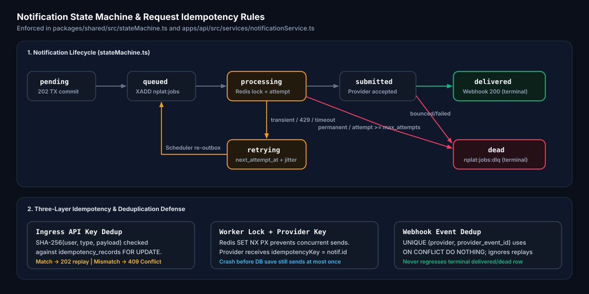

# Reliable Notification Platform — Architecture (HLD)

## Design Goal

Decouple HTTP notification ingestion (`POST /v1/notifications`) from external email delivery so that:

1. **Client retries do not create duplicate notifications or duplicate sends.**
2. **Database persistence and queue dispatch cannot diverge** across crashes (transactional outbox).
3. **Transient provider failures back off with jitter**, while permanent or exhausted failures route to a dead-letter stream.

## System Topology

| Component | Source | Instances (Compose) | Responsibility |
| --- | --- | ---: | --- |
| **Nginx Edge** | `infra/docker/nginx.conf` | 1 (`:8090`) | `least_conn` routing across two APIs; serves Console, OpenAPI docs, and Mailpit UI. |
| **API + Outbox Dispatcher** | `apps/api/src/` | 2 (`:8081`, `:8082`) | Validates tenant API keys, enforces idempotency, commits notification + outbox rows, polls outbox via `FOR UPDATE SKIP LOCKED`, handles webhooks and admin routes. |
| **PostgreSQL 16** | `packages/shared/migrations/` | 1 | Durable source of truth for tenants, keys, templates, notifications, outbox events, delivery attempts, webhook deduplication, audit events, and idempotency records. |
| **Redis 7** | `packages/shared/src/queue/`, `locking/` | 1 | Delivery stream (`nplat:jobs`, consumer group `workers`), dead-letter stream (`nplat:jobs:dlq`), and distributed locks (`nplat:lock:*`). |
| **Delivery Workers** | `apps/worker/src/` | 3 (`:9091` metrics) | Consumes `nplat:jobs` (`XREADGROUP`), reclaims stale PEL entries (`XCLAIM`), acquires per-notification Redis lock, invokes provider simulator, records attempts/retries/DLQ. |
| **Retry Scheduler** | `apps/scheduler/src/` | 1 (`:9092` metrics) | Holds distributed lock `scheduler:scan`, claims due `retrying` notifications (`next_attempt_at <= now()`), writes new `outbox_events` rows inside a transaction. |
| **Provider Simulator + Mailpit** | `apps/provider-simulator/` | 1 (`:4010`) + Mailpit | Simulates idempotent email delivery (`idempotencyKey = notificationId`), delivers SMTP mail to Mailpit (`:1025`), and posts webhook callbacks to `/v1/webhooks/email`. |
| **Prometheus + Grafana** | `infra/prometheus/`, `infra/grafana/` | 1 each (`:9093`, `:3011`) | Scrapes API, worker, and scheduler `/metrics` endpoints and plots accepted, submitted/delivered, retrying, and dead counts. |

## Core Request & Delivery Lifecycle

1. **Ingress (`POST /v1/notifications`):** `createNotification` (`apps/api/src/services/notificationService.ts`) locks any matching `idempotency_records` row (`FOR UPDATE`), compares a SHA-256 hash of `(user, type, payload)` (`409` on mismatch, replay on match), validates the recipient and published `email` template, and commits the `notifications` (`pending`), `outbox_events`, `audit_events`, and `idempotency_records` rows in one Postgres transaction before returning `202 Accepted`.
2. **Outbox Dispatch:** `OutboxDispatcher` (`packages/shared/src/outbox/dispatcher.ts`) runs inside each API process, claims up to 100 pending/stale-publishing rows via `FOR UPDATE SKIP LOCKED`, `XADD`s each job to `nplat:jobs`, marks the outbox event `published`, and transitions the notification to `queued`.
3. **Worker Execution & Locks:** Workers consume from group `workers`, acquire `nplat:lock:notif:<id>` via Redis `SET ... NX PX`, verify the notification is claimable and non-terminal (`isTerminal`), transition `status` to `processing` (`attempt_count + 1`), log a `delivery_attempts` row, and call the provider with `idempotencyKey: notificationId`.
4. **Callbacks, Retries & DLQ:** Provider 2xx moves the notification to `submitted`; `/v1/webhooks/email` deduplicates `provider_event_id` and transitions `submitted -> delivered`. Transient failures schedule `retrying` with full-jitter exponential backoff (`500 ms` base, `30 s` cap); permanent failures or exhausted attempts move the notification to `dead` and append to `nplat:jobs:dlq`.

## Key Tradeoffs & Deliberate Boundaries

- **At-least-once delivery + idempotent sinks instead of distributed 2PC:** A worker can crash between receiving provider acceptance and persisting `submitted`. Passing `notificationId` as the provider's idempotency key ensures a retry or PEL reclaim does not send a second email.
- **Email-only runtime scope:** Earlier SMS/push paths were removed from active API validation, templates, and provider calls so the reliability guarantees stay focused and verifiable end-to-end. Legacy base columns (`phone`, `push_token`, `send_at`, `user_preferences`) remain in `001_init.sql` for schema compatibility.
- **Shared-secret webhook auth:** `POST /v1/webhooks/email` checks `x-webhook-secret` against `WEBHOOK_SECRET`. A production provider integration would replace this with HMAC-SHA256 payload signatures and timestamp replay windows.
- **Single-host Compose deployment:** `docker-compose.prod.yml` hides Postgres, Redis, Prometheus, Grafana, and Mailpit off host ports and joins an external `portfolio-edge` proxy network rather than introducing Kubernetes or Terraform abstractions.
